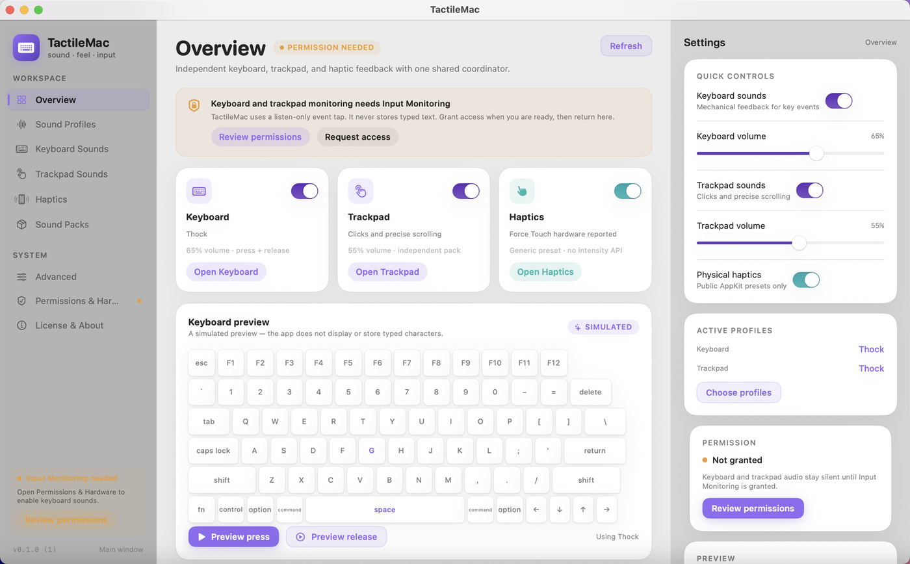

# TactileMac

A native macOS desktop app for mechanical keyboard sounds, trackpad audio, physical haptics, and validated sound packs.



TactileMac is an original Swift/SwiftUI implementation. It runs as a real resizable desktop window with a three-column layout: navigation on the left, a keyboard/trackpad/haptic workspace in the center, and contextual settings on the right. A menu-bar shortcut is optional; it is not the primary interface.

## What is implemented

- **Keyboard audio** from a listen-only global `CGEventTap`.
  - Key down and key up, modifiers (including Caps Lock as a press), and configurable key-repeat sounds.
  - Duplicate suppression, pressed-key tracking, and secure-input handling.
  - Four original built-in profiles: Thock, Clicky, Linear, Soft.
  - Independent volume, pitch variation, release-sound toggle, modifier toggle, and repeat toggle.
- **Low-latency AudioQueue engine** (`AudioToolbox`).
  - Samples decoded to interleaved Float32 stereo before playback.
  - 32-voice pool, per-voice pitch resampling, shared keyboard/trackpad volume, soft `tanh` limiter.
  - Default-output device listener, wake recovery, queue rebuild, and 128/256/512/1024-frame engine buffers.
  - Measured event-to-first-mix latency is shown in the app. Output latency reported by CoreAudio is shown separately.
- **Trackpad audio** for events public APIs can actually observe:
  - Left/right/middle button down, with debounce.
  - Precise scroll deltas, with a scroll accumulator, rate limit, momentum filter, and "precise only" filter.
  - Independent volume and sound pack.
- **Physical haptics** through the public `NSHapticFeedbackManager` API.
  - Generic, alignment, and level-change presets; independent keyboard/click/scroll triggers.
  - No private frameworks and no fake intensity control.
- **Sound-pack system**:
  - Native versioned JSON schema (`tactilemac.pack` v1).
  - Legacy V1/V2 and extended V2 importers.
  - Ogg Vorbis/Opus, WAV, MP3, and FLAC decoding through the system AVFoundation/Core Audio decoder (tested on this machine; see limits).
  - Folder, zip, and config-file import; path traversal and symlink rejection; per-file decode validation; segment bounds; warnings for unsupported keys and missing files.
  - Imported source files are preserved. A normalized `tactilemac.pack.json` is written beside the original config in Application Support.
  - Installed-pack list, selection for keyboard and trackpad independently, preview, reveal, rescan, and removal.
- **Full-window SwiftUI UI** with light/dark semantic colors, lavender accents, teal haptics accents, keyboard and trackpad visualizations, simulated-preview labels, system status, permission guidance, and an About/licensing page.
- **Versioned local settings** with corrupt-file backup, newer-schema rejection, and UI-test-verified persistence.

## Requirements

- macOS 14.0 or newer. This build was verified on macOS 15.6.1 (24G90) on an Apple M1 MacBook Pro.
- Xcode 16.4 with Swift 6.1.2 (Swift 5 language mode) for building.
- Input Monitoring permission for global keyboard and pointer events.
- A Force Touch trackpad for physical haptics. Public AppKit exposes three presets, not intensity.
- No Accessibility permission is requested or used. No screen recording, microphone, or network access.

## Build and run

```bash
# Generate the Xcode project (XcodeGen 2.46.0 used here)
xcodegen generate

# Debug build
xcodebuild -project TactileMac.xcodeproj -scheme TactileMac \
  -configuration Debug -destination 'platform=macOS' build

# Launch the built app
open ~/Library/Developer/Xcode/DerivedData/TactileMac-*/Build/Products/Debug/TactileMac.app
```

The project is generated from `project.yml`; edit that file rather than hand-editing `project.pbxproj`. The generated `.xcodeproj` is committed so the project is buildable without XcodeGen too.

### Tests

```bash
xcodebuild -project TactileMac.xcodeproj -scheme TactileMac \
  -configuration Debug -destination 'platform=macOS' \
  test -only-testing:TactileMacTests -parallel-testing-enabled NO

xcodebuild -project TactileMac.xcodeproj -scheme TactileMac \
  -configuration Debug -destination 'platform=macOS' \
  test -only-testing:TactileMacUITests -parallel-testing-enabled NO
```

Current results: **55 unit/integration tests and 7 UI tests pass**. See `docs/TESTING.md` for the exact environment, test list, audio measurement, and hardware-test status.

## Permissions

Input Monitoring is required for a listen-only `CGEventTap`. The app explains this on Overview, Keyboard Sounds, and Permissions & Hardware:

1. Open **System Settings → Privacy & Security → Input Monitoring**.
2. Enable TactileMac.
3. Return to TactileMac and press **Retry event tap** if the tap did not start automatically. Some macOS versions require relaunching the app after granting access.

TactileMac does not request Accessibility access, does not inspect the accessibility tree, and does not use the screen or microphone. While **Secure Event Input** is active (for example, a password prompt), macOS hides keystrokes from the app; feedback pauses and the UI says so.

## Permissions and hardware reality

- Public haptics may be available on Force Touch trackpads. This machine reports `ActuationSupported=1` through IORegistry, but that is a hardware property, not a promise that you will feel every pattern.
- Physical haptics, audible output, keyboard event delivery, and trackpad clicks/scrolls were **not** verified by a human in this environment. The automated suite verifies the engine starts, mixes voices, and reports latency; it cannot hear or feel the result.
- Public APIs cannot reliably distinguish a built-in trackpad click from a mouse click. Click audio may play for a mouse. Contact count, finger position, force stages, and arbitrary gestures are not available through the APIs used here.
- OGG decoding is performed by the OS. Ogg Vorbis and Ogg Opus were decoded on macOS 15.6.1, but an `.ogg` file is not assumed valid: every referenced file is opened and decoded during import/load, and failures are reported.

## Sound packs

TactileMac imports:

- Native `tactilemac.pack.json` schema v1.
- Legacy V1 (`key_define_type: single|multi`).
- Legacy V2 (`version: 2`, `soundup`, `-up` keys, `{0-4}` filename ranges).
- Extended V2 (`config_version: 2`, `definitions`, `[start_ms, end_ms]` timing, W3C key names).

The actual inspected corpus (18 legacy + 14 extended V2 packs) converts and loads 32/32 with warnings for genuinely unsupported keys and broken source references. Details, schemas, timing-unit differences, licensing, and fixtures are in [`docs/LEGACY_SOUNDPACKS.md`](docs/LEGACY_SOUNDPACKS.md). The native schema is in [`docs/SOUNDPACK_FORMAT.md`](docs/SOUNDPACK_FORMAT.md).

Installed packs live at:

```
~/Library/Application Support/TactileMac/SoundPacks/
```

Source `config.json` files are never rewritten. Imported packs are copied into a new folder, validated, and receive their own normalized manifest plus import provenance.

## Documentation

- [Architecture](docs/ARCHITECTURE.md)
- [Legacy sound-pack formats and compatibility](docs/LEGACY_SOUNDPACKS.md)
- [Native TactileMac sound-pack schema](docs/SOUNDPACK_FORMAT.md)
- [Feasibility and verified capabilities](docs/FEASIBILITY.md)
- [Privacy](docs/PRIVACY.md)
- [Testing](docs/TESTING.md)
- [Release](docs/RELEASE.md)

## Release status

A universal (arm64 + x86_64) Release app and a drag-install DMG are produced by:

```bash
./scripts/make_dmg.sh
```

The artifact in this environment is `dist/TactileMac-0.1.0.dmg` (SHA-256 recorded beside it). It is **ad-hoc signed, hardened runtime, and not Developer ID signed or notarized**. Gatekeeper rejects it (`no usable signature`). No signing identity or notary credentials were present. See `docs/RELEASE.md` for the remaining steps.

## License

- Source: MIT (`LICENSE`).
- Built-in synthesized audio and generated artwork: CC0-1.0 (`TactileMac/Resources/Notices/ASSET_LICENSES.md`).
- No third-party source code or audio recordings are bundled. See `TactileMac/Resources/Notices/THIRD_PARTY_NOTICES.md`.
